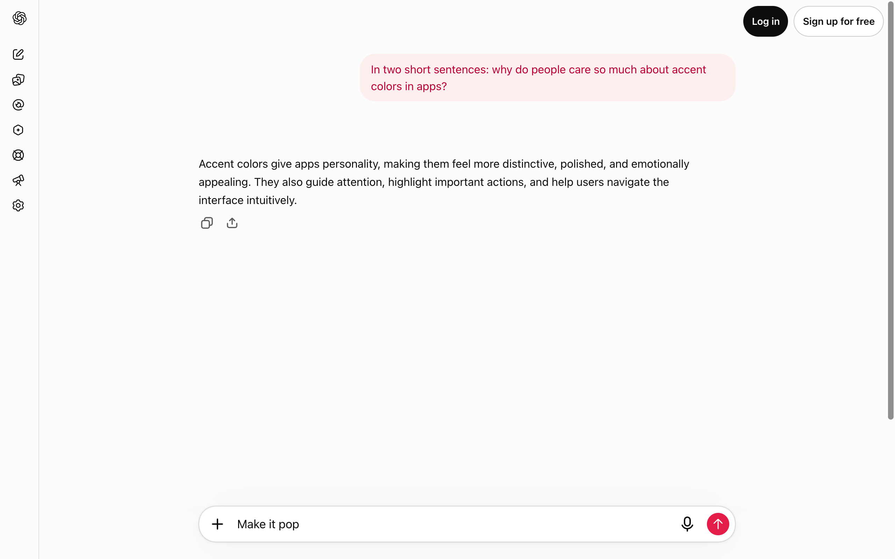
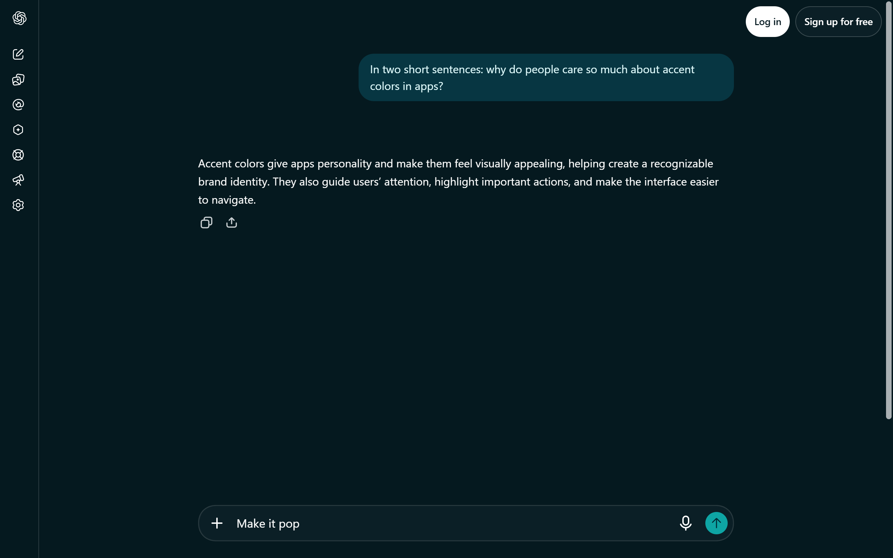
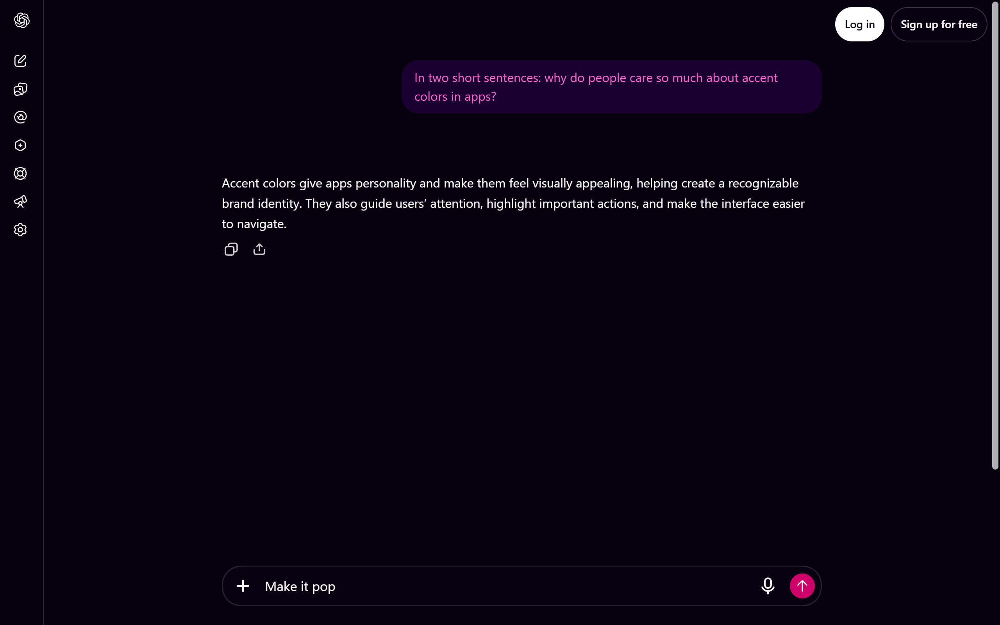
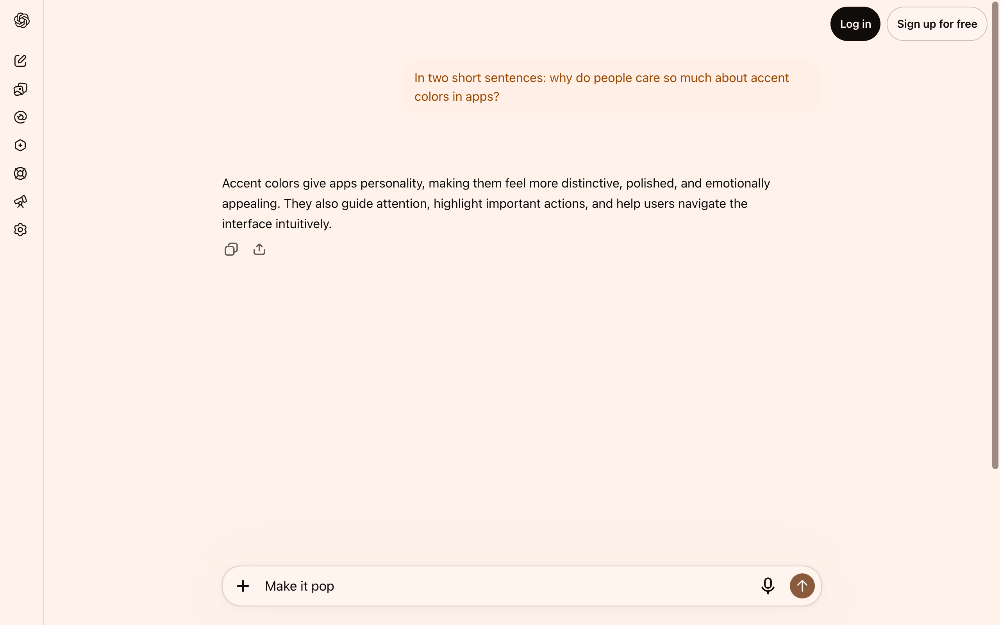
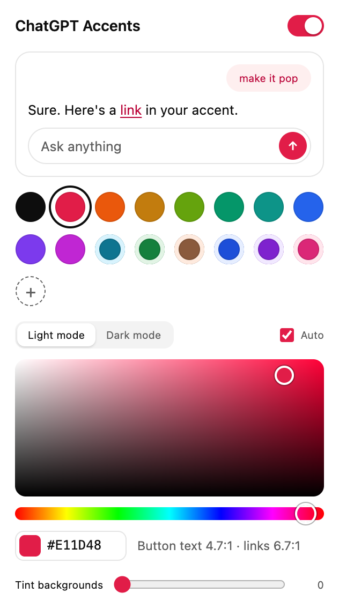

## ChatGPT Accents For All

A browser extension that lets you give ChatGPT any accent color you want. Not a menu of five. Any color, one for light mode and one for dark mode, and it fixes the text contrast for you so you can't accidentally make your chats unreadable.

I originally built this because I wanted the black accent and ChatGPT wanted 200 bucks a month for it. ChatGPT has since added its own accent setting, so this has a new job: everything the built-in setting doesn't do.

| Crimson, light mode | Ocean, dark mode with tinted backgrounds |
| --- | --- |
|  |  |
| **Synthwave, dark mode** | **Mocha, light mode** |
|  |  |

For comparison, here's [stock ChatGPT](readme-imgs/chatgpt-default-light.png). All of these are real screenshots of chatgpt.com with the extension loaded, taken by `scripts/screenshots.mjs`.

### What you get



- **Any color.** A proper picker plus a hex box, not a fixed list.
- **Separate light and dark accents.** By default the dark one is derived for you (and stays visible on ChatGPT's dark background). Pick your own if you want something completely different at night.
- **Readable no matter what.** Every text color the extension touches gets checked against WCAG contrast (4.5:1, or 7:1 if your OS asks for more contrast) and nudged lighter or darker until it passes. Pick neon yellow and the bubble text quietly turns into a readable dark gold.
- **Tint backgrounds.** Optional slider that pulls the whole interface (page, sidebar, composer) toward your accent's hue without changing lightness, so contrast stays where ChatGPT put it.
- **Presets + favorites.** 16 presets, including true black, plus a `+` button to save your own.
- **Live preview.** Changes show up instantly in every open ChatGPT tab, and in a little preview inside the popup.
- **Syncs** through your browser profile, so your colors follow you to your other computers.

### ChatGPT's own setting vs this

To be honest about it: if one of ChatGPT's built-in accents is good enough for you, use that. It's built in, it works on the phone apps, and nothing can break.

| | ChatGPT's accent setting | This extension |
| --- | --- | --- |
| Colors | A fixed set of presets | Any color |
| Light and dark | Same preset in both | Separate accents per mode |
| Backgrounds | Neutral grey only | Optional accent tint |
| Contrast | Tuned by OpenAI for its presets | Computed and fixed for whatever you pick |
| Logged out | No accent option | Works |
| Phone apps | Yes | No, desktop browsers only |
| Can break when ChatGPT updates | No | Yes (see below) |

### What it changes

Colors only. It recolors ChatGPT's accent (send button, toggles, your message bubble and its text, accent-colored text) and, if you turn on the tint, the grey surfaces and borders. It never touches the layout, never reads your chats, and never adds anything to the page except one `<style>` tag.

### Install

**Chrome, Edge, Brave, Arc and friends:** it's on the [Chrome Web Store](https://chromewebstore.google.com/detail/eojjhpainjcepfniefegkdjjemhigmgh). Heads up: if the store still says version 1.1.0, that version no longer works on today's ChatGPT. Build 2.0 from source (below) until the update lands.

**Firefox:** not on addons.mozilla.org yet. You can try it as a temporary add-on: grab `chatgpt-accents-firefox-*.zip` from the latest CI run or build it yourself (below), open `about:debugging#/runtime/this-firefox`, click *Load Temporary Add-on* and pick the zip. Firefox removes temporary add-ons when it restarts.

**From source:**

```sh
git clone https://github.com/trevor050/ChatGPTAccentsForAll
cd ChatGPTAccentsForAll
npm ci
npm run build        # -> dist/chrome and dist/firefox
```

Then open `chrome://extensions`, turn on Developer mode, click *Load unpacked* and pick `dist/chrome`. Open chatgpt.com, click the extension icon, pick a color.

### How it works (plain English)

ChatGPT's CSS is generated by StyleX, so its color variables have hashed names like `--x1e4keym` that can change whenever OpenAI ships. Instead of hardcoding those names, the extension reads ChatGPT's stylesheets and looks for the *shape* of its accent system: a group of theme classes (the ones ChatGPT's own accent picker switches between) that all override the same handful of variables with different hues. Once it finds them, it works out which variable is the button color, which is the bubble, which is text, and so on, from the colors themselves. Then it writes one stylesheet with slightly more specific selectors that wins over ChatGPT's.

Your color is mapped onto ChatGPT's own blue palette in OKLCH, so a "very light bubble tint" stays a very light tint in your hue, and a "text color" stays dark enough to read. The last token map is cached, but it is validated against the current page before any colors are applied. If the styles are still loading, colors wait for discovery rather than risk applying stale overrides.

If ChatGPT changes so much that nothing matches anymore, the extension simply does nothing and the popup tells you it couldn't find ChatGPT's colors. No half-broken page.

### Privacy

No analytics, no network requests, no remote code. Your settings live in your browser's extension storage (synced through your browser profile if you have that on). Full policy: [PRIVACY.md](PRIVACY.md).

### Development

```sh
npm test          # unit tests: color math, contrast, token discovery, v1 migration
npm run lint      # eslint + Mozilla's web-ext linter
npm run zip       # store-ready zips in dist/
npm run watch     # rebuild on change
```

The token discovery is tested against a real snapshot of chatgpt.com's CSS in `test/fixtures/`. There are also live checks that drive a real browser against chatgpt.com (they need a visible window, so they don't run in CI):

```sh
node scripts/e2e-live.mjs       # Chromium: pick a color, reload, check it stuck
node scripts/e2e-upgrade.mjs    # install v1.1.0, pick a theme, upgrade in place, check migration
node scripts/e2e-firefox.mjs    # same idea in real Firefox (needs geckodriver)
node scripts/screenshots.mjs    # regenerates the README screenshots
```

### Contributing

There will be rough edges, and ChatGPT will change again. PRs are very welcome. If it stops working, open an issue with the date and what you see. Even better, run `node scripts/e2e-live.mjs` and paste the output.

`main` is for releases. `dev` is where I work.
