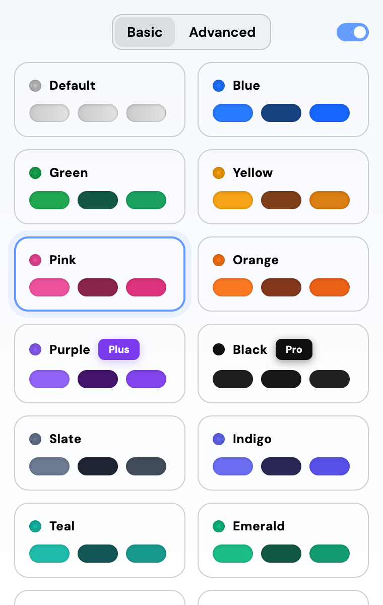
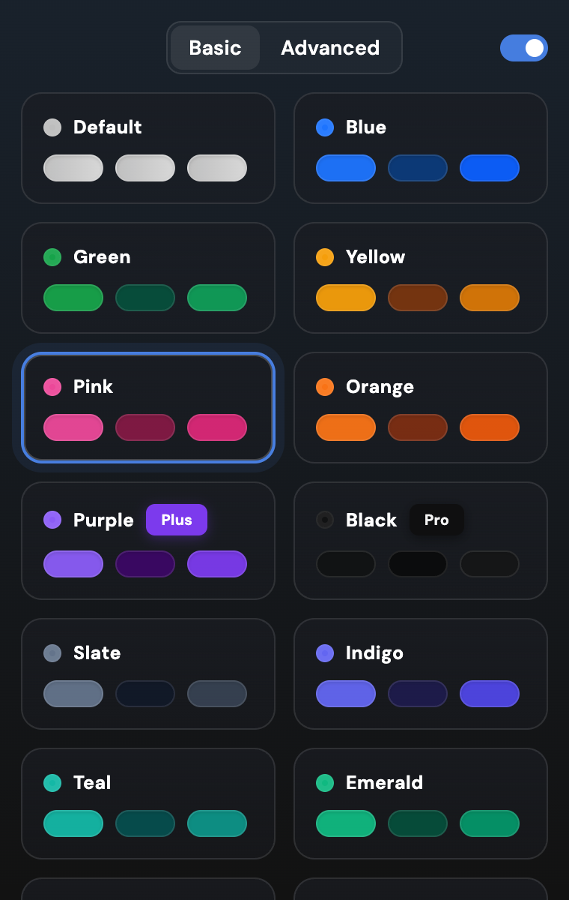
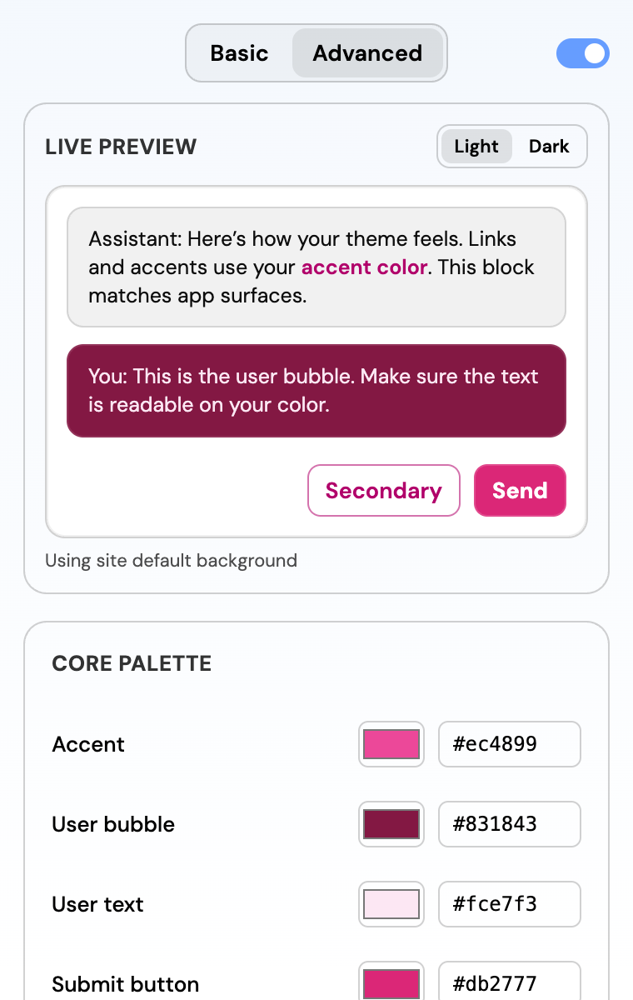
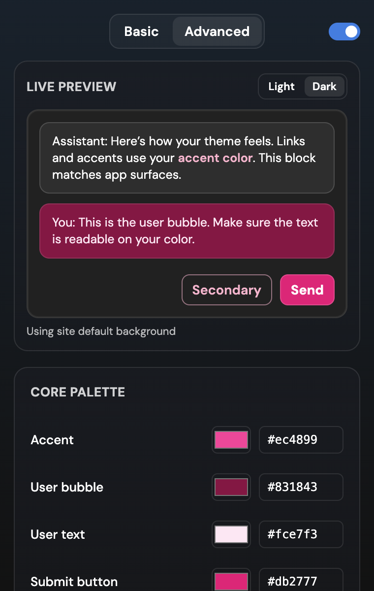

## ChatGPT Accents For All

A browser extension that themes ChatGPT. Click one of 72 named themes, or build your own: accent, message bubble, send button, even the page background. It checks the contrast for you, so you can't accidentally make your chats unreadable.

I originally built this because I wanted the black accent and ChatGPT wanted 200 bucks a month for it. ChatGPT has since added its own accent setting, so this has a new job: everything the built-in setting doesn't do.

| Default | Crimson, light mode | Ocean, dark mode |
| --- | --- | --- |
|  |  |  |
| **Synthwave, dark mode** | **Mocha, dark mode** | **Pastel Mint, light mode** |
|  |  |  |

Real screenshots of chatgpt.com with the extension loaded, taken by `scripts/screenshots.mjs`.

### The popup

| Basic | Basic, dark | Advanced | Advanced, dark |
| --- | --- | --- | --- |
|  |  |  |  |

**Basic** is the fast way. Every card is a complete look: an accent, a message bubble and its text, a send button and its arrow, and for some themes a whole page background. One click and ChatGPT changes. "Default" puts ChatGPT's own colors back.

**Advanced** is for tinkering. A live preview (flip it between light and dark), the five core colors each with a color box and a hex field, a Surfaces choice, then *Apply*, *Reset* and *Surprise me*. Save the ones you like under a name. Edits show up in the preview right away and reach ChatGPT when you hit *Apply*.

The little switch in the corner turns the colors on and off without forgetting your theme.

### What you get

- **72 themes** with their original colors, from plain accents (Blue, Green, Pink) to full looks (Mocha, Ocean, Synthwave, Game Boy, Pastel Mint). Plus *Black*, the one I built this for.
- **Every role is its own color.** Accent, bubble, bubble text, send button and send button text are chosen separately, so a theme can have a pink accent, an orange send button and a brown bubble. Leave a role empty and it's derived from the accent.
- **Readable no matter what.** Bubble text is checked against its bubble (4.5:1, or 7:1 if your OS asks for more contrast) and the arrow on the send button against the button (3:1). A pair that already passes is left exactly as designed. A pair that doesn't gets nudged just enough: 7 of the 72 themes needed it (Game Boy's bubble text gets lighter, and the white arrow on the Mint, Pastel Mint, Pastel Peach, Soft Rose, Warm Sand and Frost buttons turns dark). The list is pinned in `test/roles.test.js`.
- **Surfaces that can't wreck your eyes.** *Dark*, *Light* and *Custom* change ChatGPT's page, sidebar and composer. They never force a dark page onto light mode (dark text on a dark page was the old bug): a dark background reshapes dark mode and only lightly tints light mode, and a light one does the reverse. The popup says what each choice does.
- **Live and synced.** Changes show up instantly in every open ChatGPT tab, and your themes follow your browser profile to your other computers.
- **Works logged out.** The built-in accent setting doesn't.

### ChatGPT's own setting vs this

To be honest about it: if one of ChatGPT's built-in accents is good enough for you, use that. It's built in, it works on the phone apps, and nothing can break.

| | ChatGPT's accent setting | This extension |
| --- | --- | --- |
| Colors | A fixed set of presets | 72 themes or any colors you pick |
| Parts | One accent | Accent, bubble, bubble text, send button, send button text |
| Backgrounds | Neutral grey only | Themes can reshape or tint them |
| Contrast | Tuned by OpenAI for its presets | Checked and fixed for whatever you pick |
| Logged out | No accent option | Works |
| Phone apps | Yes | No, desktop browsers only |
| Can break when ChatGPT updates | No | Yes (see below) |

### What it changes

Colors only. It recolors ChatGPT's accent (send button, toggles, your message bubble and its text, accent-colored text) and, when a theme or Surfaces choice has its own background, the grey surfaces and borders. It never touches the layout, never reads your chats, and never adds anything to the page except one `<style>` tag.

### Install

**Chrome, Edge, Brave, Arc and friends:** it's on the [Chrome Web Store](https://chromewebstore.google.com/detail/eojjhpainjcepfniefegkdjjemhigmgh). Heads up: if the store still says version 1.1.0, that version no longer works on today's ChatGPT. Build 2.0 from source (below) until the update lands.

**Firefox:** not on addons.mozilla.org yet. You can try it as a temporary add-on: grab `chatgpt-accents-firefox-*.zip` from the latest CI run or build it yourself (below), open `about:debugging#/runtime/this-firefox`, click *Load Temporary Add-on* and pick the zip. Firefox removes temporary add-ons when it restarts.

**From source:**

```sh
git clone https://github.com/trevor050/ChatGPTAccentsForAll
cd ChatGPTAccentsForAll
npm ci
npm run build        # -> dist/chrome and dist/firefox
```

Then open `chrome://extensions`, turn on Developer mode, click *Load unpacked* and pick `dist/chrome`. Open chatgpt.com, click the extension icon, pick a color.

### How it works (plain English)

ChatGPT's CSS is generated by StyleX, so its color variables have hashed names like `--x1e4keym` that can change whenever OpenAI ships. Instead of hardcoding those names, the extension reads ChatGPT's stylesheets and looks for the *shape* of its accent system: a group of theme classes (the ones ChatGPT's own accent picker switches between) that all override the same handful of variables with different hues. Once it finds them, it works out which variable is the button color, which is the bubble, which is text, and so on, from the colors themselves. Then it writes one stylesheet with slightly more specific selectors that wins over ChatGPT's.

A theme's colors go where their jobs are: the send button color replaces the button's fill, the bubble colors replace the bubble's background and text, and the accent is mapped onto ChatGPT's own blue palette in OKLCH for everything else, so accent text stays dark enough to read. Any role a theme leaves empty is derived from the accent the same way. A page background reshapes ChatGPT's greys while keeping their lightness steps (so text contrast barely moves). The last token map is cached, but it is validated against the current page before any colors are applied. If the styles are still loading, colors wait for discovery rather than risk applying stale overrides.

If ChatGPT changes so much that nothing matches anymore, the extension simply does nothing and the popup tells you it couldn't find ChatGPT's colors. No half-broken page.

### Privacy

No analytics, no network requests, no remote code. The popup's font (DM Sans, SIL Open Font License) is bundled, not loaded from Google. Your settings live in your browser's extension storage (synced through your browser profile if you have that on). Full policy: [PRIVACY.md](PRIVACY.md).

### Development

```sh
npm test          # unit tests: color math, contrast, token discovery, theme roles, migrations, the popup
npm run lint      # eslint + Mozilla's web-ext linter
npm run zip       # store-ready zips in dist/
npm run watch     # rebuild on change
```

The token discovery is tested against a real snapshot of chatgpt.com's CSS in `test/fixtures/`. There are also live checks that drive a real browser against chatgpt.com (they need a visible window, so they don't run in CI):

```sh
npx playwright install chromium # one-time browser download for the Chromium scripts
npm run zip                    # the Firefox check installs the packaged zip
node scripts/e2e-live.mjs       # Chromium: pick a theme, reload, check it stuck
node scripts/e2e-themes.mjs     # Chromium: 12 themes in light and dark, compares what the page painted
node scripts/e2e-upgrade.mjs    # install v1.1.0, pick a theme, upgrade in place, check it comes back by name
node scripts/e2e-firefox.mjs    # same idea in real Firefox (needs geckodriver)
node scripts/screenshots.mjs    # regenerates the README screenshots
node scripts/e2e-popup.mjs      # offline, headless: drives the popup with a keyboard
```

For the Firefox check, install Firefox and put [geckodriver](https://github.com/mozilla/geckodriver/releases) on your `PATH` (`brew install geckodriver` on macOS). Windows and Linux use Selenium's installed-browser detection; set `FIREFOX_BIN` to test a different Firefox-compatible executable, such as Zen. Each run uses a fresh test profile unless you set `ACCENTS_TEST_PROFILE` to a folder to reuse across runs.

The Chromium scripts use Playwright's bundled Chromium by default. To test your installed Chrome or Edge instead, set `ACCENTS_BROWSER` to its executable. Branded Chrome has ignored `--load-extension` since version 137, so the scripts then load the extension through the DevTools protocol and remove it again when they finish.

### Contributing

There will be rough edges, and ChatGPT will change again. PRs are very welcome. If it stops working, open an issue with the date and what you see. Even better, run `node scripts/e2e-live.mjs` and paste the output.

`main` is for releases. `dev` is where I work.
